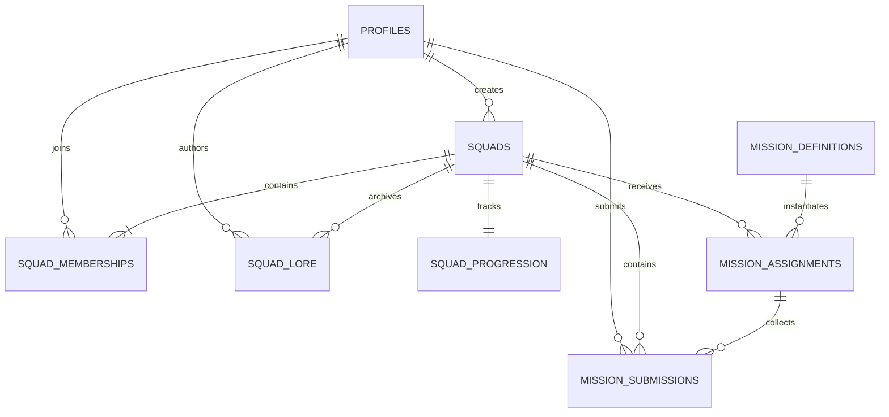

# SideQuest — Phase 3A: Backend Foundation, Database, and Security

> **Architecture Status:** Phase 3A Complete  
> **System Scope:** Backend Foundation, Database Schema, Row Level Security, Private Storage, Express API Monolith Scaffolding  
> **Target Date:** 2026-10-14  

---

## 1. Architectural Overview

SideQuest follows a hybrid architecture designed for rapid development, client security, and authoritative multiplayer gameplay:

```
+-----------------------------------------------------------------------------------+
|                                  CLIENT LAYER                                     |
|  React 19 + Vite 8 + TypeScript + React Router v7 + CSS Modules + Framer Motion  |
+----------------------------------------+------------------------------------------+
                                         |
               +-------------------------+-------------------------+
               | (Public Browser Client)                           | (API Proxy / Scoped)
               v                                                   v
+-------------------------------+                 +---------------------------------+
|        SUPABASE PLATFORM      |                 |       SIDEQUEST EXPRESS API     |
| - Supabase Auth (JWTs)        |                 | - Node.js + Express + TypeScript|
| - PostgreSQL with RLS         | <============== | - Token Verification Scaffolding|
| - Private Storage (proofs)    | (Scoped/Admin)  | - Safe Request Logger & Helmet  |
| - Security Definer Functions  |                 | - Modular Monolith Architecture |
+-------------------------------+                 +---------------------------------+
```

### Core Tenets:
1. **Supabase as Source of Truth**: Supabase handles identity, user credentials, relational data storage, and private proof media.
2. **PostgreSQL Row Level Security (RLS)**: Security boundaries are enforced in the database itself. Browser clients interact with PostgreSQL subject to fine-grained RLS policies based on `auth.uid()` and squad membership.
3. **Modular Express Monolith**: Provides centralized business operations, token verification, and an isolated execution environment for gameplay validation, AI commentary, and authoritative progression in subsequent phases.
4. **Zero-Trust Client Identity**: User IDs provided in browser request bodies or parameters are never trusted. All operations derive identity exclusively from verified JWT access tokens.
5. **No Service-Role Leakage**: The Supabase service-role key is strictly isolated to server-side background operations and is never exposed to browser bundles or `VITE_` variables.

---

## 2. Relational Database Schema & Entities

The relational database is version-controlled in `supabase/migrations/20261014000000_initial_schema.sql`.



### Entity Specifications

#### 1. `public.profiles`
Represents public adventurer identities linked 1-to-1 with Supabase Auth users.
- `id` (uuid, PK): Foreign key to `auth.users(id) ON DELETE CASCADE`.
- `display_name` (text, NOT NULL): 2–50 characters.
- `avatar_path` (text, NULLABLE): Storage key for profile picture.
- `aura` (text, DEFAULT `'midnight_rebel'`): Visual aura badge (`midnight_rebel`, `neon_goblin`, `solar_paladin`, `cosmic_mystic`).
- `created_at` (timestamptz, DEFAULT `now()`).
- `updated_at` (timestamptz, DEFAULT `now()`).
- *Automation*: Automatically provisioned via `handle_new_user()` trigger on `auth.users` insert.

#### 2. `public.squads`
Private friend groups that share a Questy companion.
- `id` (uuid, PK): `gen_random_uuid()`.
- `name` (text, NOT NULL): 2–60 characters.
- `motto` (text, NULLABLE): Squad motto or description.
- `invite_code` (text, UNIQUE, NOT NULL): Unique code for joining (e.g. `CHAOS-7729`).
- `created_by` (uuid, FK): References `profiles(id)`.
- `created_at` (timestamptz, DEFAULT `now()`).
- `updated_at` (timestamptz, DEFAULT `now()`).

#### 3. `public.squad_memberships`
Defines player roles within a squad.
- `id` (uuid, PK): `gen_random_uuid()`.
- `squad_id` (uuid, FK): References `squads(id) ON DELETE CASCADE`.
- `user_id` (uuid, FK): References `profiles(id) ON DELETE CASCADE`.
- `role` (text, NOT NULL): Check constraint `IN ('owner', 'admin', 'member')`.
- `joined_at` (timestamptz, DEFAULT `now()`).
- *Uniqueness*: `CONSTRAINT uq_squad_membership UNIQUE (squad_id, user_id)`.

#### 4. `public.squad_progression`
Authoritative progression foundation. Bypasses client-side manipulation.
- `squad_id` (uuid, PK, FK): References `squads(id) ON DELETE CASCADE`.
- `xp` (integer, DEFAULT `0`): Check constraint `xp >= 0`.
- `level` (integer, DEFAULT `1`): Check constraint `level >= 1`.
- `current_evolution_stage` (integer, DEFAULT `1`): Check constraint `BETWEEN 1 AND 5`.
  - Stage 1: Star Pup (Default)
  - Stage 2: Glow Buddy (500 XP)
  - Stage 3: Quest Pal (1,500 XP)
  - Stage 4: Star Guardian (3,500 XP)
  - Stage 5: Legendary Questy (7,000 XP)
- `streak_days` (integer, DEFAULT `0`): Check constraint `streak_days >= 0`.
- `updated_at` (timestamptz, DEFAULT `now()`).
- *Automation*: Provisioned automatically upon squad creation via `handle_squad_created()` trigger.

#### 5. `public.mission_definitions`
Canonical catalogue of daily challenges and adventures.
- `id` (uuid, PK): `gen_random_uuid()`.
- `title` (text, NOT NULL).
- `description` (text, NOT NULL).
- `category` (text, NOT NULL): Check constraint `IN ('exploration', 'creative', 'social', 'chaos')`.
- `difficulty` (text, NOT NULL): Check constraint `IN ('easy', 'medium', 'hard')`.
- `xp_reward` (integer, NOT NULL): Check constraint `xp_reward > 0`.
- `proof_type` (text[], DEFAULT `ARRAY['photo']`): Array of accepted proof modes (`photo`, `video`, `voice`, `text`).
- `rules` (text[], DEFAULT `'{}'`).
- `submission_requirements` (text[], DEFAULT `'{}'`).
- `status` (text, DEFAULT `'active'`): Check constraint `IN ('active', 'inactive', 'archived')`.
- `created_at` (timestamptz, DEFAULT `now()`).
- `updated_at` (timestamptz, DEFAULT `now()`).

#### 6. `public.mission_assignments`
Mission instances active for a specific squad.
- `id` (uuid, PK): `gen_random_uuid()`.
- `squad_id` (uuid, FK): References `squads(id) ON DELETE CASCADE`.
- `mission_id` (uuid, FK): References `mission_definitions(id) ON DELETE CASCADE`.
- `starts_at` (timestamptz, DEFAULT `now()`).
- `expires_at` (timestamptz, NULLABLE).
- `status` (text, DEFAULT `'available'`): Check constraint `IN ('available', 'in_progress', 'completed', 'expired')`.
- `created_at` (timestamptz, DEFAULT `now()`).

#### 7. `public.mission_submissions`
Multi-format proof submitted by teammates for an assigned mission.
- `id` (uuid, PK): `gen_random_uuid()`.
- `assignment_id` (uuid, FK): References `mission_assignments(id) ON DELETE CASCADE`.
- `squad_id` (uuid, FK): References `squads(id) ON DELETE CASCADE`.
- `submitted_by` (uuid, FK): References `profiles(id) ON DELETE CASCADE`.
- `proof_type` (text, NOT NULL): Check constraint `IN ('photo', 'video', 'voice', 'text')`.
- `proof_storage_path` (text, NULLABLE): Path within the `mission-proof` private storage bucket.
- `text_content` (text, NULLABLE): Text story, caption, or commentary.
- `status` (text, DEFAULT `'submitted'`): Check constraint `IN ('submitted', 'approved', 'rejected', 'flagged')`.
- `submitted_at` (timestamptz, DEFAULT `now()`).
- `reviewed_at` (timestamptz, NULLABLE).
- *Validation*: `CONSTRAINT chk_submission_has_proof CHECK (proof_storage_path IS NOT NULL OR text_content IS NOT NULL)`.

#### 8. `public.squad_lore`
Private polaroid scrapbook preserving memories, milestones, and hilarious chaos.
- `id` (uuid, PK): `gen_random_uuid()`.
- `squad_id` (uuid, FK): References `squads(id) ON DELETE CASCADE`.
- `created_by` (uuid, FK, NULLABLE): References `profiles(id) ON DELETE SET NULL`.
- `event_type` (text, NOT NULL): Check constraint `IN ('mission_completed', 'milestone_unlocked', 'chaos_moment', 'mascot_evolution', 'streak_milestone')`.
- `title` (text, NOT NULL).
- `content` (text, NULLABLE).
- `metadata` (jsonb, DEFAULT `'{}'`).
- `created_at` (timestamptz, DEFAULT `now()`).

---

## 3. Row Level Security (RLS) Architecture

Every user-accessible table has Row Level Security enabled (`ALTER TABLE ... ENABLE ROW LEVEL SECURITY;`).

### Anti-Recursion Helper Functions
Querying `squad_memberships` directly within a policy on `squad_memberships` triggers infinite recursion in PostgreSQL. To solve this safely, Phase 3A establishes two `SECURITY DEFINER` functions with an explicit schema search path (`SET search_path = public`):

```sql
CREATE OR REPLACE FUNCTION public.is_squad_member(check_squad_id uuid, check_user_id uuid)
RETURNS boolean
LANGUAGE sql
SECURITY DEFINER
SET search_path = public
STABLE
AS $$
  SELECT EXISTS (
    SELECT 1 FROM public.squad_memberships
    WHERE squad_id = check_squad_id AND user_id = check_user_id
  );
$$;

CREATE OR REPLACE FUNCTION public.get_squad_role(check_squad_id uuid, check_user_id uuid)
RETURNS text
LANGUAGE sql
SECURITY DEFINER
SET search_path = public
STABLE
AS $$
  SELECT role FROM public.squad_memberships
  WHERE squad_id = check_squad_id AND user_id = check_user_id
  LIMIT 1;
$$;
```

### Policy Matrix

| Table | Operation | Allowed Actor / Condition | Rationale |
|---|---|---|---|
| `profiles` | SELECT | `TO authenticated USING (true)` | Adventurers can view teammate profiles and avatars. |
| `profiles` | UPDATE | `auth.uid() = id` | Players can only update their own display name, avatar, or aura. |
| `squads` | SELECT | `public.is_squad_member(id, auth.uid())` | Squads are strictly private to their members. |
| `squads` | INSERT | `auth.uid() = created_by` | Any player can found a new squad. |
| `squads` | UPDATE | `get_squad_role(id, auth.uid()) IN ('owner', 'admin')` | Only squad admins or owners can edit metadata; `created_by` and `invite_code` are guarded by trigger. |
| `squads` | DELETE | `get_squad_role(id, auth.uid()) = 'owner'` | Only the squad owner can delete the squad. |
| `squad_memberships` | SELECT | `public.is_squad_member(squad_id, auth.uid())` | Members can view their squad's roster. |
| `squad_memberships` | INSERT | `get_squad_role(squad_id, auth.uid()) IN ('owner', 'admin')` | Prevents self-insertion without invite code verification. Disallows inserting a second owner. |
| `squad_memberships` | UPDATE | `get_squad_role(squad_id, auth.uid()) = 'owner'` | Only the owner can promote or demote members. |
| `squad_memberships` | DELETE | `user_id = auth.uid() OR get_squad_role(squad_id, auth.uid()) IN ('owner', 'admin')` | Members can leave freely; admins/owners can kick members; owner membership cannot be deleted. |
| `squad_progression` | SELECT | `public.is_squad_member(squad_id, auth.uid())` | Members can view live XP and evolution stages. |
| `squad_progression` | INSERT / UPDATE / DELETE | **No client policies** | Authoritative state. Only server/service-role operations can award XP. |
| `mission_definitions`| SELECT | `status = 'active'` | Authenticated players can browse active challenges. |
| `mission_definitions`| INSERT / UPDATE / DELETE | **No client policies** | Managed exclusively by administration. |
| `mission_assignments`| SELECT | `public.is_squad_member(squad_id, auth.uid())` | Squad members can view active challenges assigned to their squad. |
| `mission_assignments`| UPDATE | `public.is_squad_member(squad_id, auth.uid())` | Members can start missions (`available` -> `in_progress`). Completing missions or modifying foreign keys is blocked. |
| `mission_submissions`| SELECT | `public.is_squad_member(squad_id, auth.uid())` | Teammates can view all submissions and proofs from their squad. |
| `mission_submissions`| INSERT | `auth.uid() = submitted_by AND public.is_squad_member(squad_id, auth.uid())` | Players can only submit proof for themselves within their squad; composite FK enforces assignment belongs to squad. |
| `mission_submissions`| UPDATE | `auth.uid() = submitted_by AND status = 'submitted'` | Submitters can edit their caption/proof before final review. Relationship IDs are immutable. |
| `squad_lore` | SELECT | `public.is_squad_member(squad_id, auth.uid())` | Private scrapbook readable only by squad members. |
| `squad_lore` | INSERT | `public.is_squad_member(squad_id, auth.uid())` | Squad members can archive memories; spoofing other creators is blocked. |

---

## 4. Private Storage Architecture

A dedicated private storage bucket named `mission-proof` is configured in Supabase Storage with `public = false`.

### Bucket Specifications
- **Bucket ID**: `mission-proof`
- **Visibility**: `false` (Private. Anonymous HTTP GET requests are rejected with 403 Forbidden).
- **Max File Size**: 50 MB (`52428800` bytes).
- **Allowed MIME Types**: JPEG, PNG, WebP, GIF, MP4, WebM, MP3, WAV, M4A.

### Storage Object Layout
Files are organized hierarchically:
```
mission-proof/
  └── <squad_id>/
        └── <user_id>/
              └── <timestamp>-<uuid>.<ext>
```

### Storage RLS Policies
Storage policies in `storage.objects` strictly prevent unauthorized access and spoofed paths:

1. **Read Access (`SELECT`)**:
   Authorized squad members can download/stream proof media belonging to their squad:
   ```sql
   bucket_id = 'mission-proof' AND
   public.is_squad_member((storage.foldername(name))[1]::uuid, auth.uid())
   ```
2. **Upload Access (`INSERT`)**:
   Authenticated squad members can upload files only into their own assigned folder within their squad:
   ```sql
   bucket_id = 'mission-proof' AND
   (storage.foldername(name))[2] = auth.uid()::text AND
   public.is_squad_member((storage.foldername(name))[1]::uuid, auth.uid())
   ```
3. **Delete Access (`DELETE`)**:
   The uploader or a squad owner/admin can delete uploaded proof files:
   ```sql
   bucket_id = 'mission-proof' AND (
     (storage.foldername(name))[2] = auth.uid()::text OR
     public.get_squad_role((storage.foldername(name))[1]::uuid, auth.uid()) IN ('owner', 'admin')
   )
   ```

### Displaying Proof: Short-Lived Signed URLs
Because the storage bucket is private, image/video URLs are never exposed as public static links. To render media in the application:
1. The client or server calls Supabase Storage's `createSignedUrl` API:
   ```ts
   const { data, error } = await supabase.storage
     .from('mission-proof')
     .createSignedUrl(proofStoragePath, 300); // 5-minute validity
   ```
2. The generated time-limited signed URL (`data.signedUrl`) is used by the `` or `<video />` element.
3. Expired links automatically invalidate, preventing unauthorized leakage outside the squad.

---

## 5. Express API Foundation

The backend API is implemented as a TypeScript modular monolith located in `server/`.

### Architecture & Middleware Pipeline
```
Incoming Request
  │
  ├── 1. Helmet (Security Headers & Cross-Origin Policy)
  ├── 2. CORS (Configurable frontend origins: http://localhost:5173)
  ├── 3. Body Parser (JSON & URL-Encoded with 1 MB limit)
  ├── 4. Sanitized Request Logger (Redacts tokens, auth headers, passwords)
  ├── 5. Root & Health Handlers (/health, /ready, /api/v1/health)
  ├── 6. Modular Route Dispatcher (/api/v1/*)
  ├── 7. 404 Not Found Handler (Returns standard JSON error envelope)
  └── 8. Centralized Error Handler (Converts ApiError to structured response)
```

### Standard Error Response Format
All errors return a uniform schema with no sensitive internal details or stack traces exposed in production:
```json
{
  "success": false,
  "error": {
    "code": "UNAUTHORIZED",
    "message": "Missing or invalid Authorization header. Expected Bearer token."
  }
}
```

### Server-Side Supabase Client Strategy
1. **User-Scoped Client (`createScopedSupabaseClient(accessToken)`)**:
   - Initialized using the user's verified Bearer JWT in the `Authorization` header.
   - Executes all database queries under `auth.uid() = <caller_id>` and `auth.role() = 'authenticated'`.
   - Guaranteed to respect all PostgreSQL Row Level Security policies.
2. **Admin Service-Role Client (`getAdminSupabaseClient()`)**:
   - Initialized with `SUPABASE_SERVICE_ROLE_KEY`.
   - Bypasses RLS.
   - Reserved strictly for server-authoritative mutations (XP rewards, evolution level advancement, and cron jobs).

---

## 6. Environment Configuration Matrix

| Variable | Scope | Required In | Purpose | Never Expose In Browser |
|---|---|---|---|:---:|
| `VITE_SUPABASE_URL` | Frontend | Dev / Prod | Public Supabase project API URL | No (Public) |
| `VITE_SUPABASE_ANON_KEY` | Frontend | Dev / Prod | Public Supabase anon publishable key | No (Public) |
| `VITE_API_URL` | Frontend | Optional | URL of the Express API (e.g. `http://localhost:4000`) | No (Public) |
| `PORT` | Server | Dev / Prod | Port on which Express listens (default: `4000`) | Yes (Server) |
| `NODE_ENV` | Server | Dev / Prod | Runtime environment (`development`, `production`, `test`) | Yes (Server) |
| `FRONTEND_ORIGIN` | Server | Dev / Prod | Allowed CORS origin (e.g. `http://localhost:5173`) | Yes (Server) |
| `SUPABASE_URL` | Server | Dev / Prod | Supabase API URL for backend verification | Yes (Server) |
| `SUPABASE_ANON_KEY` | Server | Dev / Prod | Supabase anon key for public verification client | Yes (Server) |
| `SUPABASE_SERVICE_ROLE_KEY` | Server | Privileged Tasks | Secret key for privileged operations bypassing RLS | **CRITICAL: NEVER IN BROWSER** |

---

## 7. Step-by-Step Local Development Guide

### Step 1: Install Dependencies
```bash
# Install frontend dependencies
npm install

# Install server dependencies
npm run server:install
```

### Step 2: Configure Environment Files
1. Create frontend environment configuration:
   ```bash
   cp .env.example .env.local
   ```
2. Create server environment configuration:
   ```bash
   cp server/.env.example server/.env
   ```

### Step 3: Set Up Supabase (Choose Option A or Option B)

#### Option A: Local Supabase with Docker & CLI
If you have Docker Desktop and the Supabase CLI installed:
```bash
# 1. Initialize and start local Supabase services
npx supabase start

# 2. Run migrations
npx supabase migration up

# 3. Seed development missions
npx supabase db reset
```

#### Option B: Supabase Cloud (Free Hosted Project)
1. Sign in to [supabase.com](https://supabase.com) and create a new project.
2. Go to **Project Settings -> API** to retrieve your `Project URL`, `anon / public key`, and `service_role key`.
3. Go to the **SQL Editor** in the Supabase Dashboard:
   - Copy the contents of `supabase/migrations/20261014000000_initial_schema.sql` and run it.
   - Copy the contents of `supabase/seed.sql` and run it.
4. Populate your `.env.local` and `server/.env` with your project credentials.

### Step 4: Start the Applications
```bash
# Terminal 1: Start Express API server
npm run server:dev
# Running on http://localhost:4000

# Terminal 2: Start Vite Frontend
npm run dev
# Running on http://localhost:5173
```

### Step 5: Verify Backend Health
```bash
# Test health endpoint using curl
curl http://localhost:4000/health

# Expected response:
# {
#   "status": "ok",
#   "service": "sidequest-api",
#   "version": "0.1.0",
#   "environment": "development",
#   "timestamp": "...",
#   "uptimeSeconds": 10,
#   "database": { "configured": false, "hasServiceRole": false }
# }
```

### Step 6: Code Quality, Type Checks, and Builds
```bash
# Frontend build & typecheck
npm run build

# Frontend linting
npm run lint

# Server typecheck
npm run server:typecheck

# Server build
npm run server:build
```

---

## 8. Verification Results (Phase 3A)

During the implementation of Phase 3A, the following tests were executed:
- **`npm run build`**: Frontend TypeScript checks and Vite production bundling succeeded (0 errors).
- **`npm run lint`**: Oxlint verified all 52 source files (0 warnings, 0 errors).
- **`npm run server:typecheck`**: Server TypeScript strict compilation succeeded (0 errors).
- **`npm run server:build`**: Server compiled to `server/dist/` with ES module output (0 errors).
- **Server Health Check**: Started the built Express server on port 4000; queried `GET /health` and `GET /api/v1/health`, both returning HTTP 200 with structured JSON.
- **Server Error Handling Check**: Tested `GET /api/v1/nonexistent`; returned HTTP 404 with structured JSON envelope, Helmet security headers, and sanitized logging.
- **Background Server Cleanup**: Terminated test process cleanly.

---

## 9. Scope Boundaries & Known Limitations

- **Authentication UI**: Full authentication screens (magic link / OTP / social login) and session listeners remain in mock state until Phase 3B.
- **Gameplay Business Logic**: Mission proof evaluation, XP awarding formulas, evolution milestones, and squad invites remain client-side simulations in this foundation phase.
- **AI Processing Pipeline**: Multimodal Questy commentary and automatic verification flags will be wired to the Express API in a subsequent phase.

---

## 10. Recommended Next Step: Phase 3B

**Phase 3B: Supabase Authentication and Squad Session Integration**
1. Implement Supabase Auth UI (Magic Link / Email OTP / OAuth login).
2. Replace local mock session state in `SquadContext` with authenticated profile and squad subscriptions.
3. Wire the squad onboarding flow (`/onboarding`) to create actual squad rows via Supabase with automatic progression triggers.
4. Implement invite code joining flow using the `join_squad_with_code()` security definer function.
